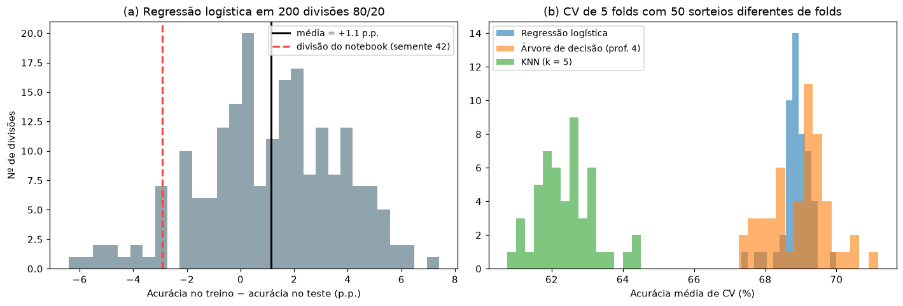
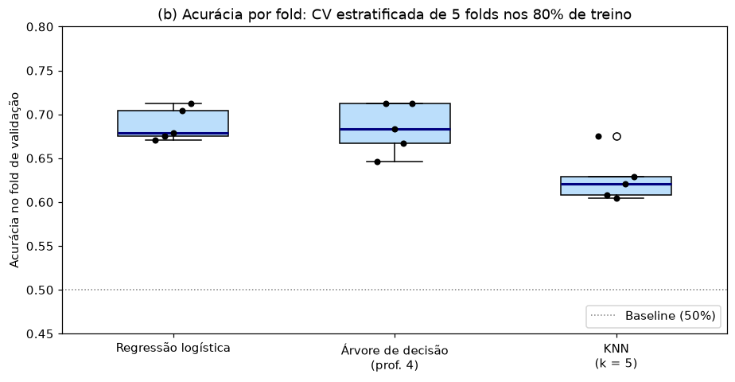
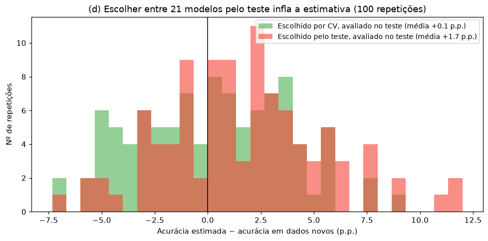
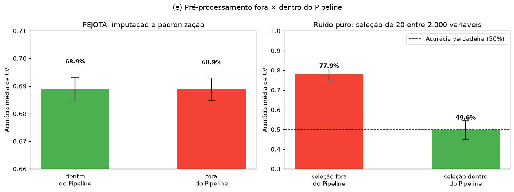
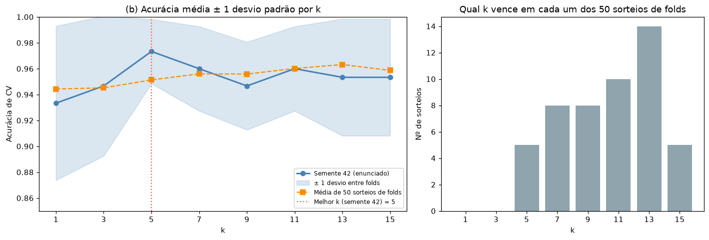

# Validação Cruzada: Escolher e Avaliar Modelos sem se Enganar

Uso de validação cruzada (CV) para comparar modelos e escolher hiperparâmetros, na base de inadimplência PEJOTA e na base Iris. Além das questões da lista, o projeto mede por simulação os três erros que a validação cruzada existe para evitar: confiar em uma única divisão treino/teste, escolher o modelo olhando para o teste e deixar o pré-processamento "ver" os dados de validação.

## Principais resultados

- **Uma única divisão treino/teste é uma estimativa ruidosa.** O conjunto de teste do notebook (semente 42) é mais "fácil" que 92% das divisões possíveis. Por isso a regressão logística teve acurácia **maior no teste do que no treino** (73,7% contra 70,8%), ao contrário do que se espera. Em média, sobre 200 divisões, o treino supera o teste em 1,1 ponto.
- **A CV escolhe bem os modelos ruins, mas não desempata os bons.** O KNN fica claramente atrás. Já entre logística e árvore, a "vencedora" depende de como os folds são sorteados: em 50 sorteios, a logística vence em 42% e a árvore em 58%.
- **Escolher o modelo pelo teste infla a estimativa.** Escolhendo o melhor entre 21 modelos pelo conjunto de teste, a acurácia anunciada é, em média, 1,7 ponto maior que a obtida em dados novos. Escolhendo por CV e avaliando no teste, a diferença cai para 0,1 ponto.
- **O vazamento depende do tipo de pré-processamento.** Padronizar e imputar fora do Pipeline não muda nada na base PEJOTA (diferença < 0,2 ponto). Selecionar variáveis fora do Pipeline, em dados de puro ruído, produz 78% de acurácia em CV para um modelo cuja acurácia real é 50%.

## Estrutura do projeto

```
validacao-cruzada/
├── data/
│   └── base_pejota.xls            
├── src/
│   ├── config.py                  # caminhos, semente, folds, nº de repetições
│   ├── data.py                    # leitura e preparação da base, divisão 80/20
│   ├── models.py                  # pipelines: logística, árvore, KNN
│   ├── q17_pejota.py              # Questão 17, itens (a) a (c)
│   ├── q17_vazamento.py           # item 17(e): vazamento, demonstrado com dados
│   ├── q17_complementos.py        # variabilidade, viés de seleção, CV aninhada
│   ├── q18_iris.py                # Questão 18 e CV repetida
│   └── utils.py                   # salvar tabelas e figuras
├── tests/
│   └── test_validacao.py          # pré-processamento, reprodução do notebook, vazamento
├── results/
│   ├── figures/                   # gráficos usados neste README
│   └── tables/                    # tabelas em CSV
├── main.py
├── requirements.txt
└── README.md
```

As respostas do enunciado ficam em `q17_pejota.py` e `q18_iris.py`. O item 17(e) ganhou um módulo próprio, `q17_vazamento.py`, porque a resposta conceitual é acompanhada de duas demonstrações numéricas. As simulações, que são a parte mais demorada, ficam em `q17_complementos.py` e podem ser puladas com `--sem-complementos`.

A base Iris vem embutida no scikit-learn (`sklearn.datasets.load_iris`) e não precisa de arquivo em `data/`.

## Dados

São 1.500 empresas, 50% inadimplentes, e 20 variáveis: todas as colunas exceto `COD_CLI` e `STATUS`. Como no notebook, `UF` é codificada como número (MG = 0, RJ = 1, SP = 2), e a imputação e a padronização ficam dentro dos pipelines.

---

## Questão 17: validação cruzada na base PEJOTA

### (a) Acurácia no treino × no teste definitivo

20% da base (300 empresas, estratificadas) foram separados como teste definitivo. A regressão logística foi treinada nos outros 80% (1.200 empresas).

| | Acurácia |
|---|---|
| Treino (80%) | 70,8% |
| Teste definitivo (20%) | **73,7%** |

O esperado seria o contrário: o modelo foi ajustado nos dados de treino, então avaliá-lo neles tende a ser otimista. Aqui, porém, **a acurácia no teste foi maior.** Isso acontece por dois motivos:

1. **O otimismo do treino é pequeno para este modelo.** Uma regressão logística com 20 coeficientes e 1.200 observações tem pouca capacidade de "decorar" os dados. Repetindo a divisão 80/20 com 200 sementes diferentes, o treino supera o teste em média por apenas **1,1 ponto**, e em 32% das divisões o teste fica acima do treino.
2. **Um teste de 300 empresas tem margem de erro grande.** O erro padrão de uma acurácia de ~70% com n = 300 é de 2,5 pontos, o que dá um intervalo de 95% de ±5 pontos.



A regra geral continua válida: a acurácia no próprio treino é uma estimativa otimista, e quanto mais flexível o modelo, maior o otimismo (uma árvore sem limite chega a 100% no treino). Mas para modelos simples, esse otimismo pode ser menor que a variação aleatória de um único conjunto de teste.

### (b) CV estratificada de 5 folds nos 80% de treino

| Modelo | Acurácia média | Desvio padrão | Pior fold | Melhor fold |
|---|---|---|---|---|
| **Regressão logística** | **68,8%** | 1,7 | 67,1% | 71,3% |
| Árvore de decisão (prof. 4) | 68,4% | 2,6 | 64,6% | 71,3% |
| KNN (k = 5) | 62,8% | 2,5 | 60,4% | 67,5% |



A logística tem a maior média e o menor desvio entre folds, ou seja, é a mais estável. O KNN fica ~6 pontos atrás, uma diferença bem maior que a variação entre folds, e já tinha aparecido no projeto de KNN.

**Entre logística e árvore, a diferença (0,4 ponto) não é real.** Os modelos são avaliados nos mesmos folds, e fold a fold a logística ganha em dois, perde em dois e empata em um. Repetindo a CV com 50 sorteios diferentes de folds, as médias ficam em 68,9% (logística) e 69,0% (árvore), e **a logística vence em apenas 42% dos sorteios**. Com uma diferença desse tamanho, a escolha entre as duas deveria vir de outro critério, como a interpretabilidade, e não de qual teve a maior média em uma CV.

### (c) O melhor modelo pela CV, avaliado no teste definitivo

| | Acurácia |
|---|---|
| CV de 5 folds no treino (logística) | 68,8% |
| Teste definitivo | 73,7% |
| Diferença | −4,8 pontos |

A CV **subestimou** o desempenho no teste, em ~1,9 erro padrão do teste. Isso é explicado pela análise do item (a): o teste desta divisão está entre os 8% mais fáceis. Na média das 200 divisões, a acurácia de teste da logística é de 70,4%, a apenas 1,5 ponto da estimativa de CV.

A CV também tende a ser levemente pessimista: em cada fold, o modelo é treinado com 960 empresas, e não com as 1.200 do modelo final. Das duas estimativas, **a da CV é a mais confiável**: ela é a média de 5 avaliações em 1.200 empresas, enquanto o teste é uma avaliação única em 300.

### (d) Por que escolher o modelo pelo conjunto de teste é problemático

O conjunto de teste serve para estimar o desempenho do modelo em dados que ele nunca viu. Quando ele é usado para **escolher** entre vários modelos, deixa de ser "nunca visto": a escolha se adapta às particularidades daquela amostra. Entre muitos candidatos, o vencedor tende a ser aquele que teve sorte com aqueles 300 casos, e a acurácia anunciada para ele fica otimista. É o mesmo problema dos testes múltiplos em estatística: quanto mais modelos se comparam no mesmo teste, maior o viés.

**Medindo o viés.** Em 100 repetições, a base foi dividida em treino (60%), teste (20%) e "dados novos" (20%, nunca usados para nada). Em cada uma, 21 modelos (logística, árvores com profundidade de 1 a 10 e KNN com k de 1 a 37) foram treinados e o melhor foi escolhido de duas formas:

| Critério de escolha | Acurácia estimada | Acurácia em dados novos | Otimismo |
|---|---|---|---|
| Melhor no **teste**, avaliado no próprio teste | 72,5% | 70,8% | **+1,7 ponto** |
| Melhor na **CV do treino**, avaliado no teste | 71,2% | 71,1% | +0,1 ponto |



Escolher pelo teste promete 1,7 ponto a mais do que o modelo entrega. Escolher por CV e só depois olhar o teste dá uma estimativa praticamente sem viés. Nesta base o viés é moderado, porque muitos dos candidatos são parecidos entre si. Com mais candidatos, conjuntos de teste menores ou modelos mais diferentes, ele cresce.

**Validação cruzada aninhada.** A própria CV também fica otimista quando é usada para escolher: o melhor escore de CV entre 21 modelos é, por construção, o máximo de 21 estimativas ruidosas. Na simulação, a CV prometia 71,9% para o modelo que escolheu, e ele entregou 71,1% em dados novos. A solução é a **CV aninhada**: uma CV interna escolhe o modelo, e uma CV externa avalia o processo inteiro de escolha. Nos 80% de treino do notebook, a seleção entre os 21 candidatos escolheu uma árvore de profundidade 2, com CV de 71,1%. A CV aninhada estimou o mesmo valor, 71,1% ± 1,9, e o modelo teve 75,7% no teste definitivo, que é o mesmo conjunto "fácil" do item (a).

**Regra prática:** a CV (ou um conjunto de validação) serve para escolher; o teste é usado **uma única vez**, no final, para o modelo já escolhido.

### (e) Por que o pré-processamento deve ficar dentro do Pipeline

Imputação, padronização e seleção de variáveis **aprendem** algo com os dados: medianas, médias, desvios, quais variáveis são boas. Se isso for feito com a base inteira antes da CV, o fold de validação participou do aprendizado, e a estimativa deixa de ser a de "dados nunca vistos". Dentro de um `Pipeline`, o `cross_val_score` reajusta cada etapa só com os folds de treino, a cada rodada, exatamente como aconteceria com dados novos.

**Quanto isso importa depende do que se aprende.** O projeto mede dois casos:



| Caso | Fora do Pipeline | Dentro do Pipeline | Verdade |
|---|---|---|---|
| PEJOTA: imputação + padronização (20 sorteios de folds) | 68,88% | 68,88% | — |
| Ruído puro: escolher 20 de 2.000 variáveis (20 repetições) | **77,9%** | 49,6% | 50% |

- **Na base PEJOTA, padronizar fora do Pipeline não muda nada** (diferença média de 0,00 ponto, máxima de 0,17). A média e o desvio de 1.200 empresas mudam muito pouco quando se retira um quinto delas, e a mediana usada na imputação também. Esse tipo de vazamento existe, mas é pequeno quando a base é grande e o pré-processamento é simples.
- **Com seleção de variáveis, o vazamento é enorme.** Com 200 observações, 2.000 variáveis de puro ruído e rótulos aleatórios, não há nada a aprender, e a acurácia real de qualquer modelo é 50%. Escolhendo as 20 variáveis mais associadas ao alvo **usando todos os dados**, algumas parecem preditivas por acaso, inclusive nos folds de validação. A CV reporta 78% de acurácia. Refazendo a seleção dentro de cada fold, a CV reporta corretamente ~50%.

Colocar todo o pré-processamento dentro do Pipeline é a forma de não precisar avaliar caso a caso se o vazamento é pequeno ou grande: com o Pipeline, ele simplesmente não acontece.

---

## Questão 18: escolha de k no KNN (Iris)

### (a) CV estratificada de 5 folds (semente 42)

| k | Acurácia média | Desvio padrão | Flores erradas (de 150) |
|---|---|---|---|
| 1 | 93,3% | 6,0 | 10 |
| 3 | 94,7% | 5,4 | 8 |
| **5** | **97,3%** | 2,5 | **4** |
| 7 | 96,0% | 3,3 | 6 |
| 9 | 94,7% | 3,4 | 8 |
| 11 | 96,0% | 3,3 | 6 |
| 13 | 95,3% | 4,5 | 7 |
| 15 | 95,3% | 4,5 | 7 |

O melhor k é **5**, com 4 flores erradas em 150. A padronização fica dentro do Pipeline, como no item 17(e).

### (b) Acurácia em função de k



As faixas de ±1 desvio padrão se sobrepõem para todos os valores de k: entre o melhor (k = 5) e o pior (k = 1), a diferença é de 6 flores. **Há um platô de k = 5 a k = 15**, onde as diferenças são de no máximo 4 flores, menores que a variação entre folds.

**Repetindo a mesma CV com 50 sorteios de folds**, k = 5 é o melhor em apenas 5 deles. Na média dos 50 sorteios, a melhor é k = 13 (96,3%), e todos os valores entre 7 e 15 ficam entre 95,6% e 96,3%:

| k | Média em 50 sorteios | Vezes como melhor k |
|---|---|---|
| 1 | 94,4% | 0 |
| 3 | 94,5% | 0 |
| 5 | 95,1% | 5 |
| 7 | 95,6% | 8 |
| 9 | 95,6% | 8 |
| 11 | 96,0% | 10 |
| 13 | **96,3%** | **14** |
| 15 | 95,9% | 5 |

**Os 97,3% de k = 5 na semente 42 foram, em parte, sorte da divisão em folds.** A recomendação, de que dentro de um platô é razoável preferir um k um pouco maior, é confirmada pelos dados: valores maiores de k fazem a média sobre mais vizinhos, o que dá fronteiras de decisão mais suaves e menos sensíveis a flores individuais. Os valores de 1 e 3 são consistentemente piores.

---

## Ferramentas

Python, scikit-learn, pandas, NumPy, Matplotlib, joblib, xlrd e pytest.
